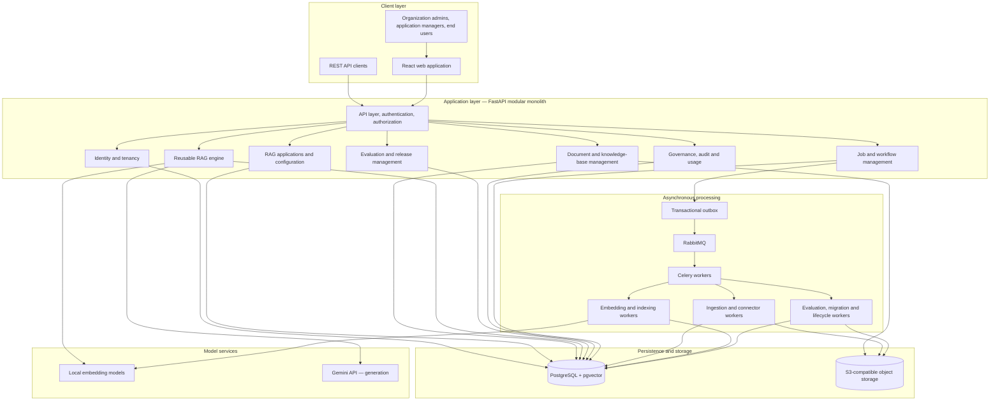
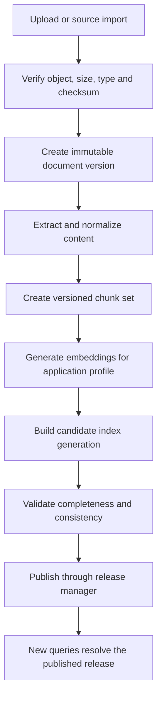
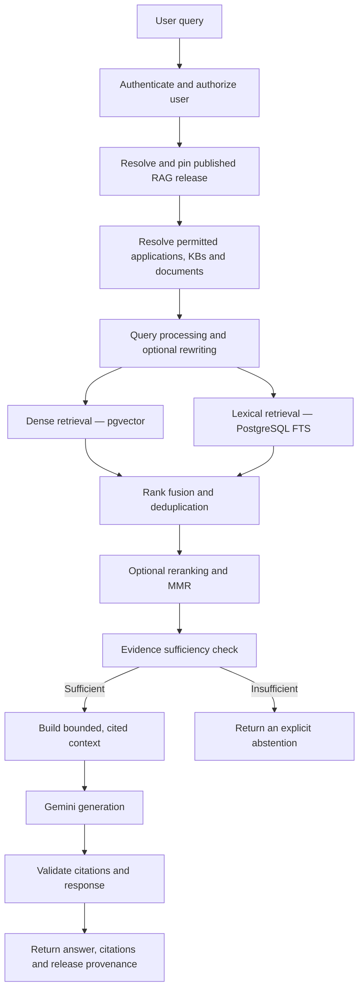
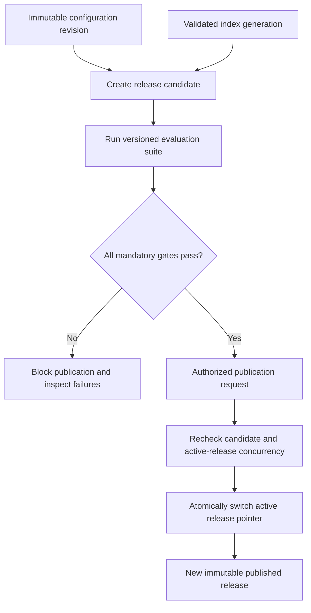

# RAGForge

### A platform for building, managing, evaluating, and operating production-grade RAG applications.

RAGForge is a **self-service, multi-tenant Retrieval-Augmented Generation (RAG) platform** designed to help organizations turn their knowledge sources into reliable AI applications.

It brings document ingestion, versioning, storage, embedding, retrieval, generation, evaluation, access control, and lifecycle management into one configurable platform. Instead of building a separate RAG pipeline for every use case, teams configure applications on top of a reusable RAG engine and operate them through consistent APIs and workflows.

> **Project status:** Architecture and conceptual design are established; implementation is beginning. The capabilities and architecture described below represent the intended design and roadmap. Features will be marked as implemented only after they are built and validated. No production deployment, benchmark result, or quality score is claimed at this stage.

---

## Why RAGForge?

A working RAG demo is relatively easy to build. Operating RAG reliably across teams, documents, permissions, model changes, and production workloads is much harder.

A production system must answer questions beyond *“Can the model retrieve a relevant chunk?”* It must also answer:

- Which exact document version supported an answer?
- Can one customer or employee ever retrieve another customer's restricted content?
- What happens when a document is replaced while its previous version is being queried?
- How can an embedding model be migrated without taking the active application offline?
- Can a configuration be evaluated before it reaches production?
- Can a failed worker resume without duplicating work or publishing stale results?
- How are deleted documents removed from search, storage, caches, and derived artifacts?
- Can retrieval quality, latency, cost, and answer grounding be measured continuously?

RAGForge is being designed around these operational requirements. **The focus is not just RAG generation; it is the correctness and lifecycle of the entire RAG system.**

## Core capabilities

The following capabilities are part of the product design. Their implementation will be delivered incrementally.

| Capability | What it is intended to provide |
|---|---|
| **Multi-tenant workspaces** | Organizations, memberships, roles, groups, and tenant-scoped resources. |
| **Self-service RAG applications** | Create and manage multiple independently configured RAG applications. |
| **Knowledge-base management** | Logical collections for documents, metadata, access policies, and index generations. The MVP starts with one knowledge base per RAG application; the data model is designed to extend to multiple knowledge bases. |
| **Document lifecycle** | Direct uploads, immutable document versions, chunk sets, replacement, archival, deletion, and restoration. |
| **Configurable RAG engine** | A reusable engine assembled from validated, versioned application configuration. |
| **Hybrid retrieval** | Dense vector search and lexical search, with fusion and optional reranking. |
| **Advanced RAG** | A roadmap for query rewriting, multi-query retrieval, decomposition, MMR, compression, and adaptive retrieval. |
| **Grounded generation** | Evidence-aware context construction, source citations, and abstention when evidence is insufficient. |
| **Evaluation and release management** | Versioned evaluation suites, quality gates, release candidates, controlled publication, and rollback. |
| **Durable background processing** | Jobs, attempts, checkpoints, retries, worker recovery, and transactional event delivery. |
| **Governance and observability** | Authorization history, audit events, usage tracking, metrics, traces, and retention workflows. |
| **External source synchronization** | An initial read-only S3-compatible source connector. Imported files are copied into RAGForge-managed storage; the connector does not modify or delete customer source objects. Additional connectors are future extensions. |

---

## Design principles

RAGForge is being built around a small set of architectural invariants.

### 1. One reusable engine, many applications

Each RAG application owns its configuration and model profiles. A shared engine interprets the published configuration and composes supported processing, retrieval, ranking, and generation components. Applications do not require separate copies of the RAG implementation.

### 2. Tenant isolation is enforced throughout the system

A shared PostgreSQL deployment can serve multiple organizations, but tenant ownership is explicit in the data model. Authorization is enforced by the backend and reinforced through relational constraints and, where appropriate, PostgreSQL Row-Level Security.

### 3. Document versions are immutable

Replacing a file creates a new document version. The old version is not overwritten. Processing a document with a different extraction or chunking specification creates a separate chunk set.

### 4. Published generations define searchable knowledge

The latest accepted upload is not automatically searchable. An immutable index-generation manifest identifies the exact document versions and chunk sets included in a searchable snapshot.

### 5. Releases are reproducible snapshots

A published RAG release binds an exact configuration revision to the relevant knowledge-base generation or generations and their embedding profiles. A query pins a release and uses it consistently throughout execution.

### 6. Background work is recoverable

PostgreSQL is the source of truth for job state. The message broker transports work; it does not own business state. Workers are designed for at-least-once delivery, idempotent processing, checkpoints, bounded retries, leases, and fencing tokens.

### 7. Quality and security are release requirements

Retrieval quality, citation support, faithfulness, abstention, tenant isolation, and version consistency are measured. Security and consistency violations are hard failures, not metrics that can be averaged away.

---

## System architecture

The initial architecture is a **modular monolith with independently running background workers**. This keeps the development and deployment model manageable while retaining clear domain boundaries and the option to extract services later when scale or operational evidence justifies it.



### Main architectural components

| Component | Responsibility |
|---|---|
| **React frontend** | Organization administration, application setup, knowledge-base management, ingestion monitoring, query interface, and evaluation views. |
| **FastAPI backend** | REST APIs, authentication context, authorization, business rules, configuration validation, and orchestration. |
| **RAG engine** | Configuration-driven query processing, retrieval, ranking, context construction, generation, and citation handling. |
| **PostgreSQL + pgvector** | Relational source of truth, document metadata, chunks, embeddings, vector retrieval, full-text search, jobs, releases, and audit metadata. |
| **Object storage** | Original files, verified ingestion artifacts, and retained archives. |
| **RabbitMQ + Celery** | Asynchronous task delivery and independently scalable worker processes. |
| **Embedding runtime** | Local execution of an open-weight embedding model through Sentence Transformers and PyTorch. |
| **Generation provider** | Gemini API integration behind a provider abstraction. |
| **Observability** | Structured logs, traces, metrics, latency, usage, and operational diagnostics. |

### Initial storage direction

- **PostgreSQL** is the primary persistence layer. pgvector supports dense retrieval, while PostgreSQL full-text search supports lexical retrieval.
- **SeaweedFS** is the initial local-development object-storage choice through its S3-compatible interface.
- **Ceph RGW** is a candidate for a more production-oriented distributed object-storage deployment; it is not required for local development.
- The first vector-storage layout will use a fixed embedding dimension compatible with the selected initial model (currently planned at 768 dimensions); support for additional dimensions will be introduced through an explicit storage/indexing design rather than mixing incompatible vectors.
- The application will use a storage abstraction so that storage-provider choices do not leak into document-processing logic.

---

## Document ingestion and publication

Ingestion is asynchronous. A verified upload becomes an immutable document version, then moves through extraction, cleaning, chunking, embedding, validation, and publication.



### Version and generation consistency

Suppose document version V1 is in the active generation while V2 is being processed. Queries continue to use V1 until a candidate generation containing V2 has passed validation and been published. Accepting a replacement does not itself change the searchable corpus.

An index generation is an immutable manifest of the exact document versions, chunk sets, and embedding profile represented by that snapshot. A RAG release binds the snapshot to an immutable application configuration. New queries pin one release; they do not independently resolve “latest” at each retrieval stage.

This separation is designed to prevent stale workers, partial ingestion, and concurrent replacements from publishing inconsistent knowledge.

---

## Query and retrieval flow

The query API is designed to resolve the active release, enforce authorization, retrieve evidence, generate a grounded response, and return citation provenance.



**Security invariant:** unauthorized evidence must not enter the generation context. Authorization is enforced server-side during retrieval and checked again before evidence is sent to the generation provider. A prompt instruction or removal of a citation after generation is not an authorization control.

### Retrieval roadmap

The initial retrieval baseline is designed around dense and lexical retrieval, rank fusion, optional reranking, context construction, and citation mapping. Advanced retrieval capabilities will follow once the baseline is stable and measurable.

Planned advanced techniques include:

- Query rewriting and expansion.
- Multi-query retrieval and query decomposition.
- Metadata-aware filtering and routing.
- Reciprocal Rank Fusion (RRF) and deduplication.
- Maximal Marginal Relevance (MMR).
- Parent-child retrieval.
- Reranking and context compression.
- Evidence sufficiency checks and corrective/adaptive retrieval.

Each technique should be evaluated independently for retrieval quality, answer quality, latency, and cost. Complexity will be added when measured improvements justify it.

---

## Multi-tenancy and access control

RAGForge is designed for shared infrastructure with logical tenant isolation.

The authorization model separates identity, administrative authority, and content access:

1. **Global identity:** a user has one platform identity, mapped to an external identity-provider subject where applicable.
2. **Organization membership:** a user can belong to multiple organizations and have a different role in each.
3. **Organization roles:** govern administrative capabilities such as managing members or RAG applications.
4. **Application access:** controls which RAG applications a user may use.
5. **Knowledge-base grants:** group-based access to a logical knowledge base.
6. **Document restrictions:** can narrow knowledge-base access for sensitive documents, but cannot grant access beyond the knowledge-base grant.

The effective decision is an intersection of the required checks. Group membership at one layer does not override a denial at another layer.

Additional design requirements:

- Tenant identifiers are not credentials; tenant scope comes from verified identity and membership.
- Backend authorization is mandatory. Frontend filtering is not a security boundary.
- Permission changes invalidate or bypass stale authorization-dependent caches.
- Platform support is metadata-only by default. Temporary content access requires explicit authorization and auditing.
- Legal preservation does not automatically grant retrieval access.

---

## Evaluation and release management

RAGForge treats an application configuration and knowledge generation as a candidate that must be evaluated before publication.



A configuration change requires a new configuration revision and a fresh evaluation of the new candidate—even when the change does not require re-embedding documents. For example, changing a reranker or retrieval `top_k` can change answer quality and latency without changing the stored vectors.

### Initial quality gates

These are **target acceptance thresholds**, not achieved results.

| Metric | Initial target |
|---|---:|
| Recall@5 | ≥ 0.80 |
| Citation precision | ≥ 0.90 |
| Faithfulness | ≥ 0.85 |
| Correct abstention | ≥ 0.90 |
| Cross-tenant leakage in security tests | 0 |
| Mixed-version responses in consistency tests | 0 |

Security and version-consistency checks are hard gates. A candidate that violates either must not be published, regardless of its other scores.

### Initial performance targets

These are engineering targets to validate under a documented benchmark workload; they are not measured performance claims.

| Measurement | Initial target |
|---|---:|
| Standard hybrid retrieval p95, excluding LLM generation | ≤ 500 ms |
| HNSW query p95 | ≤ 100 ms |
| End-to-end query p95, including generation | ≤ 15 s |
| Benchmark corpus | 100,000 chunks |
| Concurrent query workload | 25 concurrent requests |

Benchmark reports should record hardware, dataset, tenant distribution, embedding profile, index configuration, concurrency, warm-up conditions, and model-provider conditions. Concurrency should not be presented as requests per second.

---

## Reliability and lifecycle correctness

### Background execution

Long-running work is represented by durable jobs. Each job can have multiple execution attempts and checkpoints. The intended execution model uses:

- PostgreSQL as the authoritative job-state store.
- A transactional outbox to bridge database commits and queue delivery.
- RabbitMQ for message transport.
- Celery workers for ingestion, embedding, evaluation, connector synchronization, and lifecycle operations.
- Idempotent consumers to tolerate at-least-once message delivery.
- Bounded retries with exponential backoff and jitter.
- Worker leases and fencing tokens to prevent stale workers from committing after losing ownership.

### Embedding migrations

Embedding profiles are application-scoped and immutable. A migration builds vectors for a target profile without overwriting the active profile's vectors. It records a starting knowledge-base snapshot and processes subsequent authoritative changes before publication. A candidate must be complete, consistent, and evaluated before a new release can use it.

Rollback to a previous embedding profile is a rebuild-or-catch-up operation against the latest eligible corpus. RAGForge does not assume an old generation remains current simply because its release is retained.

### Retention and deletion

The current design establishes these defaults, subject to organization policy, platform limits, legal obligations, and legal holds:

- Superseded content becomes ineligible for new retrieval as soon as its replacement is published.
- Archived chunks and embeddings are verified before searchable database copies are removed.
- Searchable-copy cleanup has a 30-day target window.
- The default permanent-deletion retention period is 90 days from the applicable lifecycle event.
- An explicit deletion immediately blocks retrieval, even while data is retained during its grace period.
- A legal hold can prevent permanent purge without restoring normal query access.

Deletion must account for source objects, chunks, embeddings, archives, caches, query traces, evaluation artifacts, and backups according to their respective retention and erasure policies. Archival is not the same as deletion.

---

## Technology direction

The initial stack is selected to keep the platform open-source-friendly, locally reproducible, and practical to develop while preserving clear provider abstractions.

| Layer | Initial technology direction |
|---|---|
| Backend language | Python 3.14 |
| API framework | FastAPI |
| Request and configuration validation | Pydantic |
| ORM and persistence | SQLAlchemy 2.x, Psycopg 3 |
| Database migrations | Alembic |
| Primary database | PostgreSQL 18 + pgvector |
| Lexical retrieval | PostgreSQL full-text search |
| Background execution | Celery |
| Message broker | RabbitMQ |
| Development object storage | SeaweedFS, S3-compatible API |
| Production storage candidate | Ceph RGW |
| Local embeddings | Sentence Transformers + PyTorch |
| Generation | Gemini API through the Google Gen AI SDK |
| Frontend | React + TypeScript + Vite |
| UI components | Material UI |
| Client-side server state | TanStack Query |
| Local infrastructure | Docker Compose |
| Python dependency management | uv |

Exact dependency versions will be pinned in the repository's dependency and lock files as the scaffold is implemented. Technology choices may be revised when compatibility tests or benchmarks provide evidence for a better option.

### Architectural choices

| Choice | Reasoning |
|---|---|
| Modular monolith first | Clear domain boundaries without the operational cost of premature microservices. |
| PostgreSQL + pgvector | One transactional source of truth for relational data, vectors, and full-text retrieval in the initial workload. |
| Application-scoped model profiles | Independent tuning, migrations, access control, and reproducibility for each RAG application. |
| Local embeddings + hosted generation | Keeps embedding execution under platform control while using Gemini for generation. |
| Object-storage abstraction | Avoids coupling document lifecycle logic to one S3-compatible provider. |
| Queue plus durable job tables | Separates message delivery from authoritative business and execution state. |

---

## Planned repository structure

The repository will evolve as implementation lands. The initial structure is expected to follow these boundaries:

```text
ragforge/
├── backend/
│   ├── pyproject.toml
│   ├── alembic.ini
│   ├── migrations/
│   ├── src/
│   │   └── ragforge/
│   │       ├── api/
│   │       ├── core/
│   │       ├── identity/
│   │       ├── organizations/
│   │       ├── applications/
│   │       ├── documents/
│   │       ├── ingestion/
│   │       ├── embeddings/
│   │       ├── indexing/
│   │       ├── retrieval/
│   │       ├── evaluation/
│   │       ├── releases/
│   │       ├── jobs/
│   │       ├── connectors/
│   │       ├── storage/
│   │       └── governance/
│   └── tests/
│
├── frontend/
│   ├── package.json
│   └── src/
│       ├── api/
│       ├── components/
│       ├── features/
│       ├── layouts/
│       ├── pages/
│       └── routes/
│
├── infrastructure/
│   ├── docker-compose.yml
│   ├── postgres/
│   ├── rabbitmq/
│   └── storage/
│
├── docs/
│   ├── architecture.md
│   ├── data-model.md
│   ├── api-design.md
│   └── decisions/
│
├── .env.example
├── .gitignore
└── README.md
```

---

## Development roadmap

The roadmap is intentionally incremental. The architecture accounts for enterprise lifecycle requirements, but the first implementation will focus on a working vertical slice.

| Milestone | Scope | Exit condition |
|---|---|---|
| **M0 — Product and architecture design** | Product requirements, system boundaries, logical data model, API workflows, and technology direction. | Design baseline documented. |
| **M1 — Platform foundation** | Repository scaffold, Docker Compose, PostgreSQL, pgvector, Alembic, FastAPI, tenant and application foundation. | Create an organization and a RAG application through working APIs. |
| **M2 — Document lifecycle** | Upload sessions, managed object storage, extraction, cleaning, chunking, immutable versions, and background jobs. | Ingest a document and inspect its versioned chunks. |
| **M3 — Baseline RAG** | Local embeddings, dense and lexical retrieval, fusion, Gemini generation, citations, and release snapshots. | Query authorized documents with version-pinned evidence. |
| **M4 — Advanced RAG and evaluation** | Query rewriting, multi-query/decomposed retrieval, MMR, reranking, compression, evaluation suites, and quality gates. | Demonstrate measured improvements through controlled comparisons. |
| **M5 — Enterprise operations** | S3 synchronization, embedding migration, retention, audit, observability, resilience, and performance testing. | Validate lifecycle recovery, isolation, and benchmark targets. |

**Current milestone:** M0 is designed. M1 is the next implementation milestone. The status of each feature will be updated as code, tests, and evidence are added.

---

## Getting started

RAGForge is at the repository/bootstrap stage. A runnable local quickstart will be added with the first implementation milestone; the commands below are not published yet because the Docker Compose services, migrations, and application entry points have not been created.

### Planned development prerequisites

- Python 3.14 and `uv`.
- Node.js LTS and npm.
- Docker and Docker Compose.
- A Gemini API key for generation integration.
- Network access to retrieve the selected open-weight embedding model on first use.

### Planned local services

- PostgreSQL with pgvector.
- RabbitMQ.
- SeaweedFS object storage.
- FastAPI application.
- Celery worker processes.
- React/Vite frontend.

Once the initial scaffold is committed, this section will contain exact setup commands, environment-variable names, migration instructions, test commands, and a working end-to-end example.

### Configuration and secrets

Local configuration will be provided through environment variables and an untracked `.env` file. Production secrets must be supplied through a secrets-management mechanism. API keys, database passwords, source-bucket credentials, and signing secrets must never be committed to the repository.

---

## Engineering standards

The project is intended to demonstrate implementation quality, not just component integration. The following practices will guide development:

- Typed request, response, and configuration contracts.
- Explicit domain ownership and transaction boundaries.
- Composite foreign keys for important tenant-scoped relationships.
- Idempotent background processing and durable checkpoints.
- Bounded connection pools, request deadlines, retries, and rate limits.
- Structured logs, correlation IDs, traces, and operational metrics.
- Unit, integration, authorization, lifecycle, and failure-recovery tests.
- Retrieval and generation evaluation using versioned datasets.
- Performance measurements that record workload and environment details.
- Documentation of architectural decisions and trade-offs.

---

## Design documentation

As implementation progresses, detailed documentation will live under `docs/`:

- **Architecture:** system context, components, data plane/control plane boundaries, and deployment model.
- **Data model:** entities, relationships, constraints, indexes, and lifecycle states.
- **API design:** endpoint contracts, validation, authorization, and error behavior.
- **Architecture decisions:** concise records explaining important choices and their trade-offs.

The README is the project overview; these documents will hold the deeper engineering specifications.

---

## Project principles

RAGForge is being developed as an engineering project with explicit attention to correctness and measurable behavior:

- **Grounded answers over plausible answers.**
- **Authorization before evidence reaches the model.**
- **Immutable versions over in-place mutation.**
- **Validated publication over implicit activation.**
- **Recoverable work over fragile background tasks.**
- **Measured retrieval quality over unverified optimization claims.**
- **Simple architecture first, complexity when justified.**

---

## License

The project license will be selected and added before public distribution. Until then, no reuse or redistribution terms should be inferred from the repository contents.

---

<p align="center">
  <strong>RAGForge</strong><br />
  <sub>Build. Retrieve. Evaluate. Operate.</sub>
</p>
